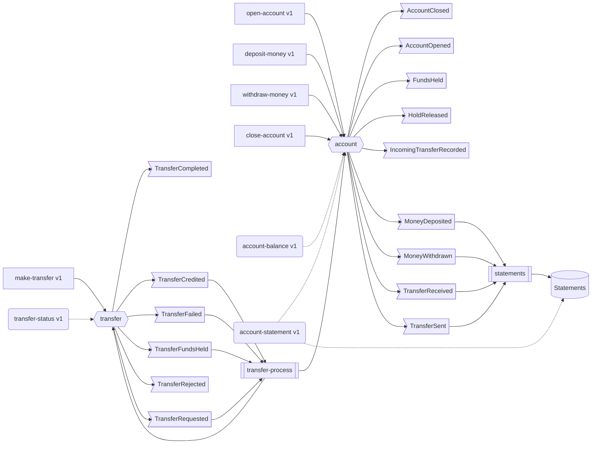

# ledger — service catalog

> Generated by `projected docs` from the code. Do not edit: run `projected docs` after changing the
> service — `projected check` fails while this file is out of date.

Flavour: **event-sourced**.

## How it fits together

Commands (rectangles) write aggregates (hexagons), which record events (flags); event handlers
(double boxes) react to them through ports (cylinders). Queries (rounded) read, along dotted lines.
Circles are broker topics, parallelograms other services.

## Operations

Served over HTTP (`POST /commands|queries/{type}/version/{n}`), in batches and from a message queue.

| Operation | Kind | Access | Business errors | Handler | Writes | Reads | Emits | Ports |
|---|---|---|---|---|---|---|---|---|
| `open-account` v1 | command | permissions: accounts:manage | `AccountAlreadyOpened` | `openAccount` | account | — | `AccountOpened` | — |
| `deposit-money` v1 | command | permissions: cash:handle | `AccountNotOpen`, `CurrencyMismatch` | `depositMoney` | account | — | `MoneyDeposited` | — |
| `withdraw-money` v1 | command | permissions: cash:handle | `AccountNotOpen`, `CurrencyMismatch`, `InsufficientFunds` | `withdrawMoney` | account | — | `MoneyWithdrawn` | — |
| `close-account` v1 | command | permissions: accounts:manage | `AccountNotOpen`, `AccountNotEmpty` | `closeAccount` | account | — | `AccountClosed` | — |
| `make-transfer` v1 | command | authenticated | `TransferToSameAccount`, `TransferIdInUse` | `makeTransfer` | transfer | — | `TransferRequested` | — |
| `account-balance` v1 | query | authenticated | — | `accountBalance` | — | account | — | — |
| `transfer-status` v1 | query | authenticated | — | `transferStatus` | — | transfer | — | — |
| `account-statement` v1 | query | authenticated | — | `accountStatement` | — | account | — | `Statements` |

## Aggregates

| Aggregate | Events | Written by | Read by | Defined in |
|---|---|---|---|---|
| `account` | `AccountClosed`, `AccountOpened`, `FundsHeld`, `HoldReleased`, `IncomingTransferRecorded`, `MoneyDeposited`, `MoneyWithdrawn`, `TransferReceived`, `TransferSent` | open-account v1, deposit-money v1, withdraw-money v1, close-account v1 | account-balance v1, account-statement v1 | `src/domain/account/account.ts` |
| `transfer` | `TransferCompleted`, `TransferCredited`, `TransferFailed`, `TransferFundsHeld`, `TransferRejected`, `TransferRequested` | make-transfer v1 | transfer-status v1 | `src/domain/transfer/transfer.ts` |

## Events

| Event | Version | Aggregate | Emitted by | Consumed by |
|---|---|---|---|---|
| `AccountClosed` | 1 | account | close-account v1 | — |
| `AccountOpened` | 1 | account | open-account v1 | — |
| `FundsHeld` | 1 | account | transfer-process | — |
| `HoldReleased` | 1 | account | transfer-process | — |
| `IncomingTransferRecorded` | 1 | account | transfer-process | — |
| `MoneyDeposited` | 1 | account | deposit-money v1 | statements |
| `MoneyWithdrawn` | 1 | account | withdraw-money v1 | statements |
| `TransferCompleted` | 1 | transfer | transfer-process | — |
| `TransferCredited` | 1 | transfer | transfer-process | transfer-process |
| `TransferFailed` | 1 | transfer | transfer-process | transfer-process |
| `TransferFundsHeld` | 1 | transfer | transfer-process | transfer-process |
| `TransferReceived` | 1 | account | transfer-process | statements |
| `TransferRejected` | 1 | transfer | transfer-process | — |
| `TransferRequested` | 1 | transfer | make-transfer v1 | transfer-process |
| `TransferSent` | 1 | account | transfer-process | statements |

## Event handlers

| Handler | Consumes | Ports | Writes | Emits | Defined in |
|---|---|---|---|---|---|
| `statements` | `MoneyDeposited`, `MoneyWithdrawn`, `TransferReceived`, `TransferSent` | `Statements` | — | — | `src/application/usecase/statement-projection.ts` |
| `transfer-process` | `TransferCredited`, `TransferFailed`, `TransferFundsHeld`, `TransferRequested` | — | account, transfer | `FundsHeld`, `HoldReleased`, `IncomingTransferRecorded`, `TransferCompleted`, `TransferCredited`, `TransferFailed`, `TransferFundsHeld`, `TransferReceived`, `TransferRejected`, `TransferSent` | `src/application/usecase/transfer-process.ts` |

## Driven ports

| Port | Operations | Adapters | Used by |
|---|---|---|---|
| `Statements` | `inMonth`, `record` | `documentStatements` | account-statement v1, statements |
