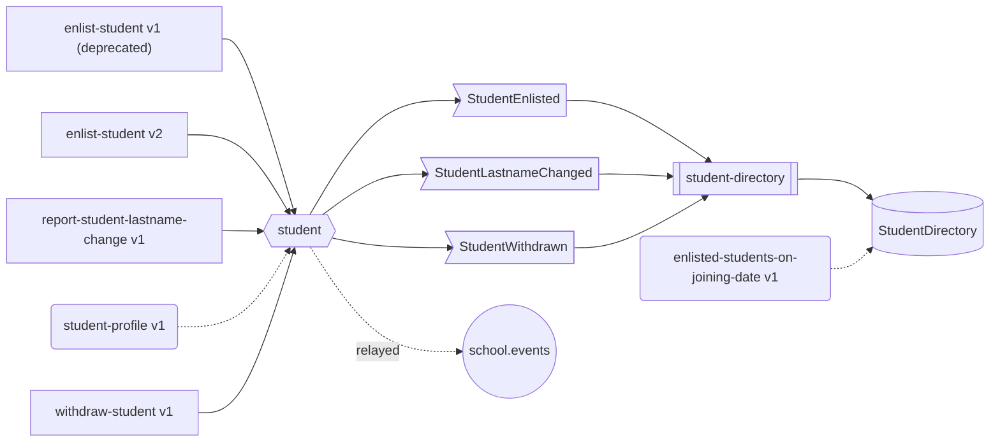

# school — service catalog

> Generated by `projected docs` from the code. Do not edit: run `projected docs` after changing the
> service — `projected check` fails while this file is out of date.

Enlists students and answers questions about them. Flavour: **event-sourced**.

## How it fits together

Commands (rectangles) write aggregates (hexagons), which record events (flags); event handlers
(double boxes) react to them through ports (cylinders). Queries (rounded) read, along dotted lines.
Circles are broker topics, parallelograms other services.

## Operations

Served over HTTP (`POST /commands|queries/{type}/version/{n}`), in batches and from a message queue.

| Operation | Kind | Access | Business errors | Handler | Writes | Reads | Emits | Ports |
|---|---|---|---|---|---|---|---|---|
| `enlist-student` v1 *(deprecated)* | command | permissions: students:manage | — | `enlistStudentV1` | student | — | `StudentEnlisted` | — |
| `enlist-student` v2 | command | permissions: students:manage | `StudentAlreadyEnlisted` | `enlistStudentV2` | student | — | `StudentEnlisted` | — |
| `report-student-lastname-change` v1 | command | authenticated | `StudentNotEnlisted` | `reportStudentLastnameChange` | student | — | `StudentLastnameChanged` | — |
| `withdraw-student` v1 | command | permissions: students:manage | `StudentNotEnlisted`, `LeavingBeforeJoining` | `withdrawStudent` | student | — | `StudentWithdrawn` | — |
| `enlisted-students-on-joining-date` v1 | query | authenticated | — | `enlistedStudentsOnJoiningDate` | — | — | — | `StudentDirectory` |
| `student-profile` v1 | query | authenticated | — | `studentProfile` | — | student | — | — |

## Aggregates

| Aggregate | Events | Written by | Read by | Defined in |
|---|---|---|---|---|
| `student` | `StudentEnlisted`, `StudentLastnameChanged`, `StudentWithdrawn` | enlist-student v1, enlist-student v2, report-student-lastname-change v1, withdraw-student v1 | student-profile v1 | `src/domain/student/student.ts` |

## Events

| Event | Version | Aggregate | Emitted by | Consumed by |
|---|---|---|---|---|
| `StudentEnlisted` | 1 | student | enlist-student v1, enlist-student v2 | student-directory, relay → school.events |
| `StudentLastnameChanged` | 1 | student | report-student-lastname-change v1 | student-directory, relay → school.events |
| `StudentWithdrawn` | 1 | student | withdraw-student v1 | student-directory, relay → school.events |

## Event handlers

| Handler | Consumes | Ports | Writes | Emits | Defined in |
|---|---|---|---|---|---|
| `student-directory` | `StudentEnlisted`, `StudentLastnameChanged`, `StudentWithdrawn` | `StudentDirectory` | — | — | `src/application/usecase/student-directory-projection.ts` |

## Driven ports

| Port | Operations | Adapters | Used by |
|---|---|---|---|
| `StudentDirectory` | `joinedOn`, `put`, `remove`, `rename` | `documentStudentDirectory` | enlisted-students-on-joining-date v1, student-directory |

## Outside the service

- Every event is relayed to the `school.events` topic.
